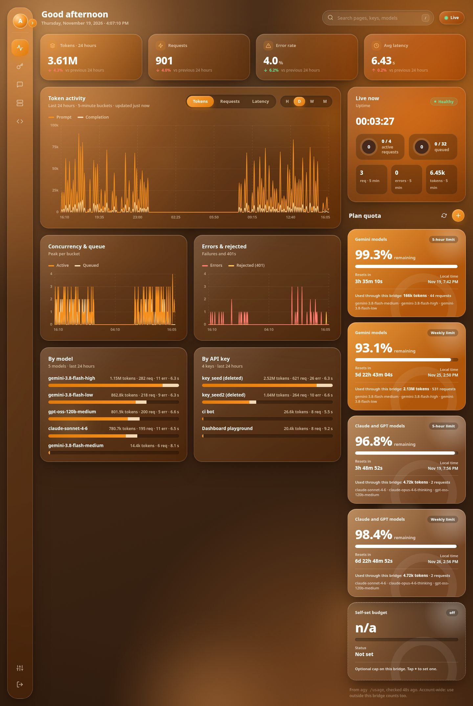
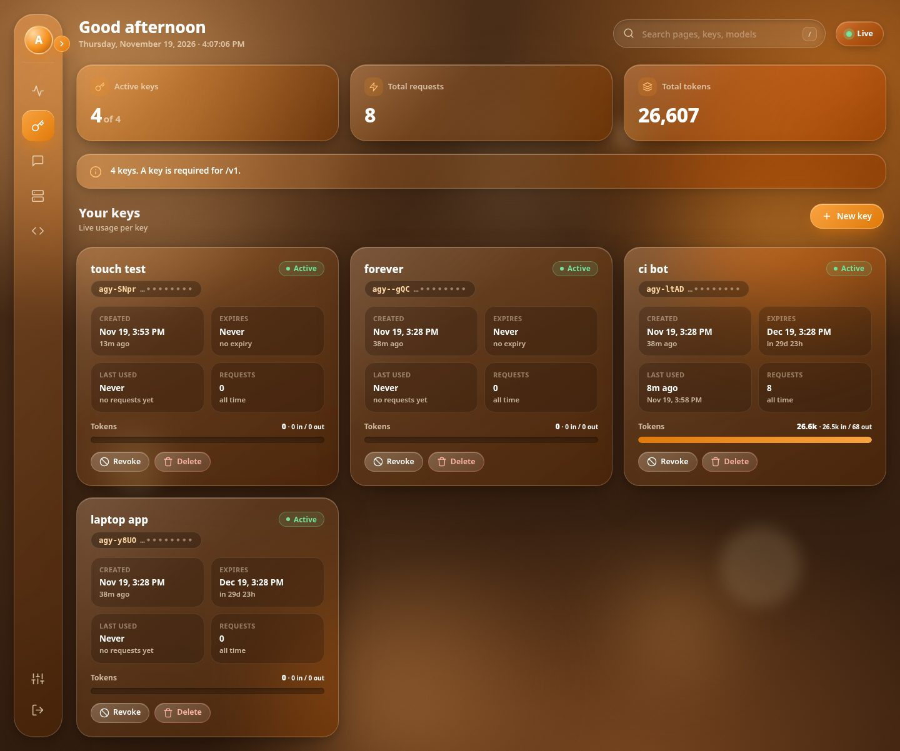

<p align="center">
  
</p>

# Antigravity to Local API

A local Node.js bridge that turns your signed-in Antigravity `agy` CLI (your Antigravity plan) into an OpenAI-compatible HTTP API. Point OpenCode, Cursor, scripts, or the official OpenAI SDKs at `http://127.0.0.1:8788/v1` and use the models on your plan from any OpenAI-compatible client.

This project is unofficial and is not affiliated with Google. You must follow Google's Antigravity terms and your plan's usage limits.

## What you can use it for

- Run coding agents such as OpenCode (CLI or Desktop) against your Antigravity models.
- Call the same models from curl, Python, or JavaScript with the OpenAI SDK.
- Manage API keys, watch live usage, and check remaining plan quota in a local dashboard.
- Give clients OpenAI-style tool calling (the bridge emulates tools in the prompt).

## Features

- OpenAI-compatible `POST /v1/chat/completions` and `GET /v1/models` (streaming SSE supported).
- Liquid glass dashboard: API keys with expiry and revoke, usage and quota graphs, playground, and a Connect screen with copy-paste setup.
- Prompt-emulated tool calling and a token-saving minimal agent (optional isolated `agy` home, compact prompts, history caps).
- Concurrency pool and queue, plus a configurable request body limit (default 64 MB) so large chat histories are not dropped.
- Optional conversation memory archive and MCP server (off by default).



## Requirements

- Node.js 22.5 or newer (uses built-in `node:sqlite` and `process.loadEnvFile`). Tested on Node 24.
- The Antigravity CLI (`agy`) installed and signed in. The default path is `~/.local/bin/agy`.
- No `npm install` step: the project uses Node.js built-in modules only.

## Quick start

```bash
git clone https://github.com/TouheedNaveed/antigravity-to-local-api.git
cd antigravity-to-local-api
cp .env.example .env
npm start
```

Open `http://127.0.0.1:8788/` (or `/dashboard`). On first visit, set an admin password (at least 8 characters). Then open **API keys**, create a key, and copy it. The full key is shown only once.

Check `http://127.0.0.1:8788/health` if you only want a status probe.

Keep `HOST=127.0.0.1`. The server loads `.env` from the project folder; existing shell variables win over `.env`. Never commit `.env` or `data/`.

## Configuration

Copy `.env.example` to `.env` and change only what you need.

| Variable | Default | Purpose |
|---|---|---|
| `HOST` | `127.0.0.1` | Bind address. Keep loopback unless you have secured remote access. |
| `PORT` | `8788` | HTTP port. |
| `AGY_BIN` | `~/.local/bin/agy` | Absolute path to the CLI if it is not in the default location. |
| `AGY_API_KEY` | blank | Optional legacy Bearer token, in addition to dashboard keys. |
| `AGY_REQUIRE_KEY` | `1` | `1` requires a valid key on every `/v1/*` call. `0` leaves the API open only while no keys exist and `AGY_API_KEY` is empty. |
| `AGY_DATA_DIR` | `./data` | Where `keys.json`, `admin.json`, and metrics live. |
| `AGY_ADMIN_ALLOWED_HOSTS` | blank | Extra `Host` names allowed for the dashboard. Loopback is always allowed. |
| `AGY_TIMEOUT_MS` | `300000` | Maximum request duration, in milliseconds. |
| `AGY_STARTUP_TIMEOUT_MS` | `45000` | How long to wait for an `agy` worker to start. |
| `AGY_QUEUE_TIMEOUT_MS` | `120000` | How long a request may wait in the queue. |
| `AGY_MAX_CONCURRENT` | `4` | Requests processed at once. |
| `AGY_MAX_QUEUE` | `32` | Maximum waiting requests. |
| `AGY_RETRIES` | `1` | Retries for a failed worker start or a classified retryable error. |
| `AGY_PREWARM` | `1` | Standby `agy` processes to keep ready per model. |
| `AGY_PREWARM_MAX` | `2` | Cap on total standby processes (each uses roughly 240 MB RAM). |
| `AGY_STANDBY_IDLE_MS` | `120000` | Idle time before a standby worker is retired. |
| `AGY_MAX_SESSION_WORKERS` | `4` | Maximum client-bound session workers. |
| `AGY_SESSION_IDLE_MS` | `300000` | Idle time before a session worker is retired. |
| `AGY_ISOLATE` | `1` | Run `agy` in a bridge-only `HOME` so your global AGY config, skills, and MCP servers are not loaded. |
| `AGY_MINIMAL_AGENT` | `1` | Drop AGY's built-in system prompt and tools (`excludeDefaultComponents`). Ignored when memory tools are on. |
| `AGY_COMPACT_PROMPT` | `1` | Shorter wrapper text around the conversation, tools, and JSON mode. |
| `AGY_MAX_HISTORY_TOKENS` | `0` | Optional cap on prompt history tokens. `0` means no cap. System messages and the last message are always kept. |
| `AGY_MAX_HISTORY_MESSAGES` | `0` | Optional cap on prompt history messages. `0` means no cap. |
| `AGY_HOME_DIR` | `./.agy-home` | Isolated AGY home directory. |
| `AGY_HOME_RETAIN_HOURS` | `12` | How long isolated home work files are kept. |
| `AGY_MEMORY_TOOLS` | `off` | `on` registers the memory MCP and adds memory policy text to the prompt. |
| `AGY_MEMORY_DIR` | `./memory` | Optional path for the conversation archive. |
| `AGY_QUOTA_POLL_MS` | `120000` | How often the dashboard refreshes plan quota via `agy /usage`. `0` disables it. |
| `AGY_MAX_BODY_MB` | `64` | Maximum request body size in megabytes. |

## Dashboard and API keys

1. Start the server and open `http://127.0.0.1:8788/`.
2. Set the admin password on first visit.
3. On **API keys**, name a key and choose an expiry (N days, a date, or never). Create it and copy the full value (`agy-` plus 43 characters). It is shown once.
4. Send it on every `/v1/*` call: `Authorization: Bearer agy-YOUR_KEY` (or the `x-api-key` header).

Only a SHA-256 hash, a display prefix, and metadata are stored in `data/keys.json`. The admin password is a scrypt hash in `data/admin.json`. That directory is gitignored.

To reset a forgotten admin password, stop the server, delete `data/admin.json`, start it, and set a new one. Keys are kept.



## OpenCode CLI and Desktop

Create a dashboard key first. Prefer storing it in a file, not in `opencode.json`.

```bash
mkdir -p ~/.config/opencode
# Paste your key on a single line, no quotes or extra spaces
nano ~/.config/opencode/agy.key
chmod 600 ~/.config/opencode/agy.key
```

Merge this provider into `~/.config/opencode/opencode.json` (keep any other providers you already have). Use your own `PORT` if you changed the default.

```json
{
  "$schema": "https://opencode.ai/config.json",
  "provider": {
    "agy": {
      "npm": "@ai-sdk/openai-compatible",
      "name": "AGY Local",
      "options": {
        "baseURL": "http://127.0.0.1:8788/v1",
        "apiKey": "{file:~/.config/opencode/agy.key}"
      },
      "models": {
        "gemini-3.8-flash-medium": { "name": "Gemini 3.8 Flash (Medium)" },
        "gemini-3.8-flash-high": { "name": "Gemini 3.8 Flash (High)" },
        "gemini-3.8-flash-low": { "name": "Gemini 3.8 Flash (Low)" },
        "claude-sonnet-4-6": { "name": "Claude Sonnet 4.6 (Thinking)" },
        "claude-opus-4-6-thinking": { "name": "Claude Opus 4.6 (Thinking)" },
        "gpt-oss-120b-medium": { "name": "GPT-OSS 120B (Medium)" }
      }
    }
  }
}
```

**CLI:** run `opencode`, then `/models`, and choose a model under AGY Local.

**Desktop:** quit and reopen OpenCode Desktop after you save the config so it reloads the provider. Then pick an AGY Local model in the model list.

You can use `{env:AGY_API_KEY}` instead of the file placeholder if you export the key in your environment. Do not paste a real key into `opencode.json` or into this repository.

The Connect tab in the dashboard also shows this config with the live base URL.

## Examples

Replace `agy-YOUR_KEY` with a key from the dashboard.

```bash
curl http://127.0.0.1:8788/v1/chat/completions \
  -H "Authorization: Bearer agy-YOUR_KEY" \
  -H "Content-Type: application/json" \
  -d '{
    "model": "gemini-3.8-flash-medium",
    "messages": [{"role": "user", "content": "Hello"}]
  }'
```

JavaScript:

```javascript
import OpenAI from "openai";

const client = new OpenAI({
  baseURL: "http://127.0.0.1:8788/v1",
  apiKey: "agy-YOUR_KEY",
});

const r = await client.chat.completions.create({
  model: "gemini-3.8-flash-medium",
  messages: [{ role: "user", content: "Hello" }],
});
console.log(r.choices[0].message.content);
```

Python:

```python
from openai import OpenAI

client = OpenAI(base_url="http://127.0.0.1:8788/v1", api_key="agy-YOUR_KEY")
r = client.chat.completions.create(
    model="gemini-3.8-flash-medium",
    messages=[{"role": "user", "content": "Hello"}],
)
print(r.choices[0].message.content)
```

Supported model IDs (also from `GET /v1/models`):

- `gemini-3.8-flash-medium`
- `gemini-3.8-flash-high`
- `gemini-3.8-flash-low`
- `claude-sonnet-4-6`
- `claude-opus-4-6-thinking`
- `gpt-oss-120b-medium`

## Tool calling

Clients can send OpenAI `tools` / `tool_calls`. The CLI has no native tool API, so the bridge asks the model to emit a `<tool_calls>` JSON block, then returns standard `tool_calls` in the chat completion. Send the tool result back in a follow-up request as a `tool` role message, the same way you would with the OpenAI API.

```bash
curl http://127.0.0.1:8788/v1/chat/completions \
  -H "Authorization: Bearer agy-YOUR_KEY" \
  -H "Content-Type: application/json" \
  -d '{
    "model": "gemini-3.8-flash-medium",
    "messages": [{"role": "user", "content": "Weather in Paris?"}],
    "tools": [{
      "type": "function",
      "function": {
        "name": "get_weather",
        "description": "Get weather",
        "parameters": {
          "type": "object",
          "properties": {"city": {"type": "string"}},
          "required": ["city"]
        }
      }
    }]
  }'
```

## Token saving

By default the bridge runs `agy` in `./.agy-home` with a tool-less minimal agent and compact wrapper text. That avoids loading your global AGY skills and MCP servers, and drops AGY's built-in system prompt.

Measured on `gemini-3.8-flash-low` (prompt tokens reported by AGY):

| Request | Before | After |
|---|---|---|
| "Say OK" | 2,040 | 441 |
| Tool call, then the tool result | 2,313 and 2,417 | 601 and 712 |
| JSON mode | 2,085 | 472 |
| 6-turn chat (client resends history), total | 12,722 | 3,112 |
| Claude Sonnet 4.6, "Say OK" | 2,705 | 992 |

AGY reports `cache_read_tokens` as 0, so every turn is billed for the whole conversation. Use `AGY_MAX_HISTORY_TOKENS` or `AGY_MAX_HISTORY_MESSAGES` if a client resends a long history. Set `AGY_ISOLATE=0` only if you want your global AGY config.

Your real `~/.gemini` is not modified. Sign-in still works because `agy` keeps credentials in the desktop keyring. The bridge must run inside your logged-in user session.

## Troubleshooting

**`ECONNRESET` or a dropped connection.** Older builds called `req.destroy()` when the body was over the limit, which looks like a reset to the client. Current builds return HTTP 413 instead. Raise `AGY_MAX_BODY_MB` if a coding agent sends a very large history (the default is 64). If a single session has grown huge, start a new chat session rather than resending the full history.

**Port already in use.** Change `PORT` in `.env`, or stop the process already bound to that port (`ss -ltnp | grep 8788`).

**401 `no_api_keys` / `invalid_api_key`.** Create a key in the dashboard and send it as `Authorization: Bearer agy-...`. A dummy value such as `local` is not accepted once keys are required.

**CLI missing or not signed in.** Confirm `agy` works in a terminal in the same user session. Set `AGY_BIN` if the binary is not at `~/.local/bin/agy`.

**OpenCode Desktop does not see the provider.** Confirm the key file path and `baseURL` port, then fully quit and reopen the app.

**Cursor cannot reach `127.0.0.1`.** Some Cursor setups run outside your machine's loopback. The API is local by default; do not bind to `0.0.0.0` unless you understand the risk and have locked it down.

## Security

- Keep `HOST=127.0.0.1`. Do not expose this server to the network without additional access control.
- Never commit `.env`, `data/`, `.agy-home/`, `memory/` databases, `*.key`, or logs.
- Dashboard admin routes do not accept API keys. State-changing calls need the session cookie, a CSRF token, `X-Requested-With: agy-dashboard`, a same-origin `Origin`, and a loopback `Host` header (or a name listed in `AGY_ADMIN_ALLOWED_HOSTS`).
- Treat dashboard keys like passwords. Revoke a key if it leaks.

See [SECURITY.md](SECURITY.md) to report a vulnerability.

## Contributing

Issues and pull requests are welcome. See [CONTRIBUTING.md](CONTRIBUTING.md) for setup, tests, and the branch workflow.

## Author

Created and maintained by [Touheed Naveed](https://github.com/TouheedNaveed).

## License

A license has not been chosen yet. Please do not assume you have rights beyond viewing and experimenting until a license is added. The upstream project also ships without a license file.

## Disclaimer

This is an unofficial community project. It is not endorsed by Google. Use it only with an Antigravity account you are allowed to use, and only in ways that comply with Google's terms and policies.
